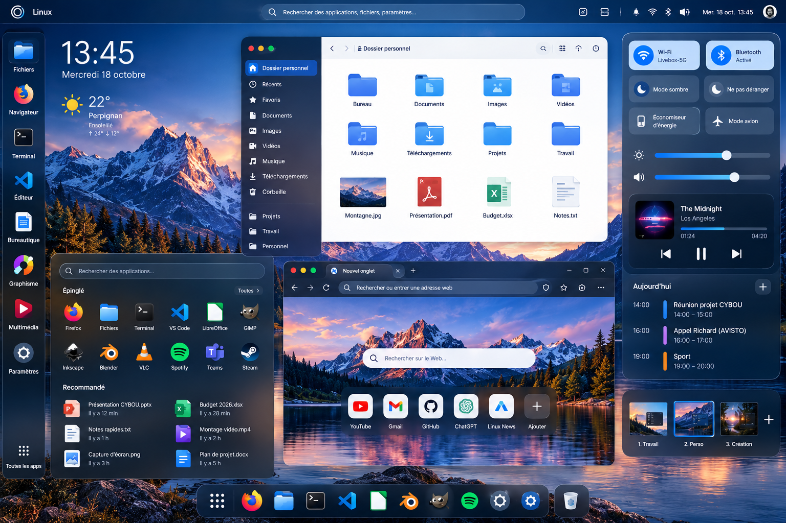
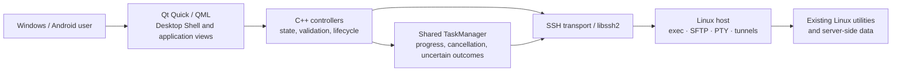

# FORTIQ

### An agentless Linux desktop, built with C++20, Qt Quick and SSH

**FORTIQ turns a Linux host into a coherent native workspace without installing a remote desktop environment or a proprietary server agent.** Files, documents, terminal, logs, networking, system tools, databases, mail and browser views are presented in one Qt-based shell. Remote operations use SSH, SFTP, PTY and SSH tunnelling; the Linux host remains the authority for working data.

[Architecture](docs/ARCHITECTURE.md) · [Product scope](docs/PRODUCT_SCOPE.md) · [Desktop UX acceptance](docs/DESKTOP_EXPERIENCE_RELEASE_MATRIX.md) · [Build and verification](#build-and-verification) · [GPL-3.0 license](LICENSE)

> **Project status — October 2026:** Public source code and an actively developed engineering prototype, **not a production-qualified release**. Historical Windows and Android-emulator checks are documented, but current end-to-end builds, clean-install qualification, physical-device testing, security review and visual acceptance remain open. CI is intentionally disabled; no build or tests were run as part of this README update.



*Approved desktop design reference — **not** a captured screenshot of a validated application build. See [UI specification](docs/UI_SPEC_V1.md) and [shell fidelity](docs/SHELL_FIDELITY.md).*

## Why FORTIQ exists

Remote Linux access is often fragmented across SSH terminals, file-transfer utilities, log viewers and web dashboards. FORTIQ explores a different boundary: **keep computation and working data on the Linux server, while giving the user a cohesive, native desktop experience.** The client provides the interaction layer; it does not emulate a remote graphical session.

This repository is also an **open software and systems architecture case study**. It exposes architectural decisions, implementation boundaries, security trade-offs, verification plans and unresolved risks rather than only showcasing features.

## System architecture



### Decisions, constraints and trade-offs

| Decision | Engineering reasoning | Evidence |
| --- | --- | --- |
| **Agentless SSH-first boundary** | Reuse mature SSH facilities and established Linux tools rather than maintain a custom server service. Host capabilities and utility versions still affect behavior. | [SSH frontend contract](docs/SSH_FRONTEND_CONTRACT.md), [SSH implementation](src/ssh/) |
| **Remote identity is explicit** | Bind actions and asynchronous results to server/session identity so late work cannot silently apply to another host. | [Architecture](docs/ARCHITECTURE.md), [controllers](src/core/) |
| **Uncertain outcomes are represented honestly** | A connection failure after a potentially started mutation is not proof of cancellation. Task lifecycle models include an **unknown** result. | [TaskManager](src/core/TaskManager.cpp), [SSH operations](src/core/RemoteOperations.cpp) |
| **Secure operations before convenience** | SSH host-key verification, OS-backed secret handling, guarded session shutdown, conflict handling and document-draft preservation reduce avoidable data-loss risks. They are controls, not a claim of formal security certification. | [Architecture](docs/ARCHITECTURE.md), [Smart Files](docs/SMART_FILES_SPEC.md), [MDok](docs/MDOK.md) |
| **Share mechanisms, not every behavior** | Task tracking, connection-loss warnings, dialogs and state presentation are shared; editors, logs and terminals keep their own domain-specific state. | [DesktopShell](qml/shell/DesktopShell.qml), [TaskPanel](qml/shell/TaskPanel.qml), [AppStateMessage](qml/shell/AppStateMessage.qml) |
| **Responsive desktop is a distinct UX problem** | Window ordering, keyboard focus, modal dialogs, touch input and virtual keyboards need explicit handling, not a uniformly scaled desktop screenshot. | [UI contract](docs/UI_SPEC_V1.md), [Android foundation](docs/ANDROID_FOUNDATION.md) |
| **Specifications are not test results** | Source-level hardening, tests present in the repository, executed test evidence and release acceptance are documented separately. | [Release readiness matrix](docs/DESKTOP_EXPERIENCE_RELEASE_MATRIX.md), [test sources](tests/) |

The implementation follows an architectural workflow: **problem framing → constraints → contracts → implementation → threat and failure review → verification evidence → release gate**. See [documentation authority](docs/DOCUMENTATION_AUTHORITY.md) for how design contracts and implementation reports are distinguished.

## Applications and shared capabilities

| Area | Current source-level scope | Details |
| --- | --- | --- |
| **Smart Files** | SFTP directory navigation, previews, search, transfer/operation flows, trash and conflict handling | [Files specification](docs/SMART_FILES_SPEC.md) |
| **MDok** | Remote Markdown editing, preview, document tabs/drafts and save-conflict workflows; PDF-related behavior needs platform validation | [MDok](docs/MDOK.md) |
| **Logs** | Journald/file sources, filtering, grouping and incident inspection, without requiring AI | [Logs specification](docs/LOGS_INTELLIGENCE_SPEC.md) |
| **Terminal** | Interactive SSH PTY, terminal rendering and session lifecycle | [Terminal](docs/TERMINAL.md) |
| **System, Network, Disks** | Host information and operational diagnostics through Linux utilities | [System](docs/SYSTEM.md) · [Network](docs/NETWORK.md) · [Disks](docs/DISKS.md) |
| **Databases** | SQLite and PostgreSQL inspection with read-only-oriented UI safeguards; the remote account's permissions remain the actual security boundary | [Databases](docs/DATABASES.md) |
| **Mail** | Linux-tool-based mail workflows, including reading, composing and server-side attachments | [Mail](docs/MAIL.md) |
| **Browser** | Server-routed browsing architecture with platform-specific engine work and a text-mode fallback; privacy and device qualification remain open | [Browser](docs/BROWSER.md) |

These describe **implemented code paths and design direction**, not universal platform support or completed feature acceptance. The shell also has shared notifications, application routing, task tracking, session handling and reusable UX components.

## Technology and supported targets

- **Languages and UI:** C++20, Qt Quick / QML, CMake; Qt 6.12 is the development target. Consult [CMakeLists.txt](CMakeLists.txt) for the actual minimum and dependencies.
- **Connectivity:** libssh2, SSH exec, SFTP, interactive PTY and SSH tunnelling.
- **Primary platform:** Windows 10/11 x64.
- **Additional target:** Android tablets / arm64, with emulator-based evidence and outstanding physical-device qualification.
- **Linux:** a Debian client packaging path exists, but is not a production-qualified release; Linux is also the remote-host environment. See [Debian packaging](docs/DEBIAN_RELEASE.md).
- **Server environment:** Debian/Ubuntu-oriented workflows and existing Linux utilities; availability of individual tools must be checked.

FORTIQ does **not** need a server-side graphical desktop or its own server daemon. It does require an accessible SSH server, suitable permissions and the Linux utilities used by the chosen app.

## Build and verification

The following is a **developer command sequence**, not evidence of a successful current build:

```sh
cmake -S . -B build -DCMAKE_PREFIX_PATH=/path/to/Qt/kit -DBUILD_TESTING=ON
cmake --build build --config Release
ctest --test-dir build -C Release --output-on-failure
```

Configure Qt and libssh2 for the same ABI/toolchain; Windows and Android have additional SDK and packaging requirements. See [migration/build history](docs/QT_MIGRATION.md), [platform qualification](docs/PLATFORM_QUALIFICATION.md), [Android foundation](docs/ANDROID_FOUNDATION.md) and [release process](docs/RELEASE.md). A Debian 13 packaging entry point is `python3 tool/package_debian.py`; see [its prerequisites and caveats](docs/DEBIAN_RELEASE.md).

### What remains before a release claim

1. Reproduce current desktop/Android builds and test suites, including real SSH integration with failure and reconnect scenarios.
2. Qualify a clean Windows install and a physical Android device, including SAF, IME and input behavior.
3. Compare captured application UI against the approved design reference and validate accessibility and responsive layouts.
4. Measure responsiveness under large listings, log streams, multiple document tabs and terminal output.
5. Close security and data-integrity review gates and document remaining limitations.

The [Desktop Experience release matrix](docs/DESKTOP_EXPERIENCE_RELEASE_MATRIX.md) is the explicit acceptance checklist. **No passing tests or release readiness are implied by the presence of source files or this README.**

## Repository map

```text
qml/shell/          Desktop Shell, application views and shared UI components
src/core/           Application controllers, remote operations and TaskManager
src/ssh/            SSH transport implementation
tests/              Automated test sources
docs/               Architecture, product contracts, security and acceptance
docs/design/        Approved visual reference
assets/branding/    Branding and executable-icon sources
tool/               Development, packaging and verification utilities
www/                Project website
```

Start with [Architecture](docs/ARCHITECTURE.md), [Product Scope](docs/PRODUCT_SCOPE.md) and [Desktop Experience Release Matrix](docs/DESKTOP_EXPERIENCE_RELEASE_MATRIX.md). For the evolution from Flutter to Qt and historical verification, read [Qt Migration](docs/QT_MIGRATION.md) and the [October 23 audit](docs/AUDIT_2026-10-23.md).

## Open development and licensing

FORTIQ is an openly developed, exploratory engineering project. The original FORTIQ code is licensed under **GNU GPL-3.0-only**; see [LICENSE](LICENSE). Dependencies and bundled third-party material retain their respective licenses; review [third-party notices](docs/THIRD_PARTY_LICENSES.md).

The project is intended to make software architecture inspectable: **what was decided, why it was decided, what is implemented and what still needs proof.**
