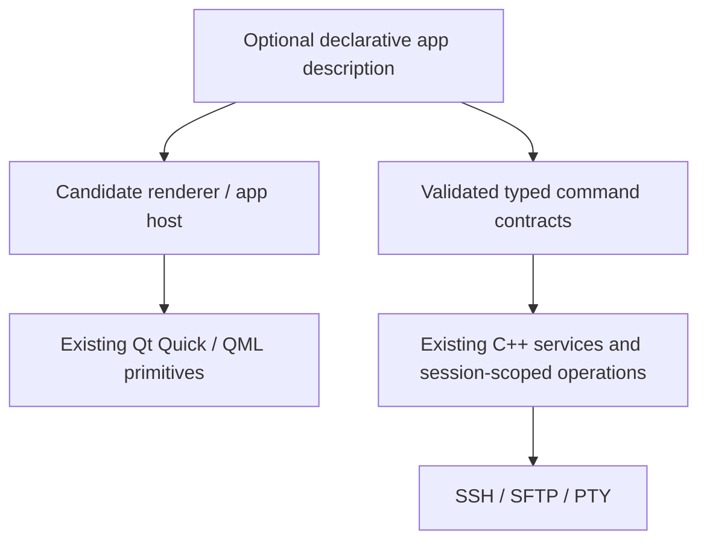

# Architecture exploration: Declarative Internal Applications & SDK

**Status:** OPEN / UNDECIDED  
**Date recorded:** 2026-10-30  
**Decision authority:** Project owner; no ADR accepted and no implementation authorized by this note.  
**Scope:** Possible future redesign of FORTIQ's *internal* applications, not a promise of a public extension platform.

## Problem statement

FORTIQ contains multiple native Qt/QML applications sharing window lifecycle, navigation, task execution, status/error presentation, server/session identity and remote operations. The current architecture uses explicit C++ controllers and QML views. As the catalog grows, repeated application scaffolding may create maintenance costs, inconsistent UI behavior and slower integration.

Question: **Would a declarative internal application model, backed by a small SDK, improve cohesion and delivery speed without sacrificing typed domain behavior, performance, security or control of remote side effects?**

This is an exploration, not an approved migration.

## Candidate direction (hypothesis only)

An internal SDK might expose:

- **Application descriptors:** stable ID, view entry, capabilities, navigation and window policies.
- **Typed data and command contracts:** schema-validated inputs and outputs, binding to existing C++ services, and explicit async states.
- **Declarative UI composition:** layout, presentation primitives, reusable state views and adaptive rules, rendered with Qt Quick/QML.
- **Shared host services:** session-scoped resource identity, task lifecycle, safe operations, notifications, clipboard, file picking and navigation, with explicit permissions.
- **Compatibility boundaries:** domain-rich applications (Terminal, Browser, MDok) could retain imperative components; declarative composition need not govern their internals.

The objective would be to **standardize integration**, not to replace Qt/QML, implement a general scripting runtime, allow arbitrary remote command templates, or introduce a server daemon.

### Possible layering, not implementation architecture

## Alternatives to evaluate

| Option | Potential gain | Main risk |
| --- | --- | --- |
| **A. Keep explicit QML + C++** | Minimum new machinery; mature Qt tooling | Repeated application scaffolding |
| **B. Reusable application templates and typed descriptors** | Incremental standardization without a new renderer | Limits to declarative flexibility |
| **C. Declarative internal app definitions + constrained SDK** | Consistent lifecycle, generated composition, easier internal app additions | New schemas, runtime, debugging and migration burden |
| **D. Full extensibility / public SDK** | Broader ecosystem in theory | Security, compatibility, API stability and support costs; **not requested or approved** |

**No option is selected.** A constrained proof of concept may eventually be compared against the current implementation, but should not precede a decision.

## Non-negotiable invariants for any future proposal

1. SSH-first, agentless system boundary; server data remains authoritative.
2. Every remote resource/action preserves explicit server and session identity.
3. Side-effecting actions require typed validation, authorization and truthful cancellation/unknown outcomes.
4. Existing document and transfer integrity safeguards must not regress.
5. No silent arbitrary execution or implicit elevation of remote privileges.
6. Qt 6.12 target, native desktop responsiveness and adaptive Android behavior.
7. Domain-specific controls remain possible; no forced one-size-fits-all declarative model.
8. Compatibility, observability, migration/rollback and measurable performance are required.

## Questions that remain open

- What precise duplication or friction would justify the SDK? Measure it first.
- What is declarative: metadata, layouts, data flows, commands, or all of these?
- QML-only descriptors, JSON/schema, or a compiled typed format?
- How are data binding, mutations, errors, navigation and state restoration modeled?
- How are capabilities constrained and audited?
- How would existing applications migrate incrementally without breaking data workflows?
- What is the SDK's audience: internal team only, or a future public extension model?
- What comparative benchmark, code-size reduction and maintainability evidence would justify adoption?

## Gate before commitment

Prepare an ADR with measured duplication, two alternative designs, a concrete prototype scope (for example a read-only system view), regression criteria, security review and an incremental rollback plan. Decide **adopt / revise / reject** only after comparison.

**Until then:** no SDK release announcement, no wholesale rewriting of existing apps, no new schema/runtime dependencies, no roadmap deadlines and no claim that declarative internal applications already exist.

Related: [Architecture](ARCHITECTURE.md) · [Product scope](PRODUCT_SCOPE.md) · [Desktop experience release matrix](DESKTOP_EXPERIENCE_RELEASE_MATRIX.md).
